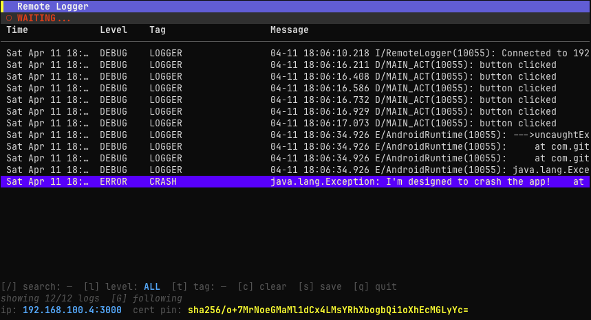

# RemoteLogger

[](https://github.com/asvid/RemoteLogger/releases)

Stream Android Logcat over WebSocket to a terminal UI on your dev machine. Useful when the device must run in release mode without developer options (USB debugging off, production build, etc.).



## How it works

The Android library reads Logcat, serializes each log line as JSON, and sends it over WebSocket to the Go server. The server displays logs in a terminal UI with filtering, level colors, and file export.

```
Android device  ──WebSocket──▶  Go server (TUI)
  logcat reader                    filter / scroll / save
```

---

## Server

### Install

```bash
brew tap asvid/homebrew-tap
brew install remotelogger
```

### Build from source

```bash
cd serverGo
go build -o remotelogger .
```

### Run

```bash
remotelogger
```

Default port is `3000`. Your IP will be shown at startup — use it in the Android config.

#### Flags

```
-p int      Port (default 3000)
-ll string  Show only logs at this level: VERBOSE | DEBUG | INFO | WARNING | ERROR
-t string   Show only logs with this tag
-f string   Also write all logs to file (filters do not apply to file output)
-no-tui     Plain stdout — useful for piping or CI
```

#### Examples

```bash
# filter to errors only
remotelogger -ll ERROR

# filter by tag and write everything to file
remotelogger -t MyActivity -f session.log

# pipe to grep (no TUI)
remotelogger -no-tui | grep "NullPointer"

# custom port
remotelogger -p 8080
```

### TUI keybindings

| Key | Action |
|-----|--------|
| `/` | Focus text search (searches tag + message) |
| `t` | Focus tag filter |
| `l` | Cycle level filter: ALL → VERBOSE → DEBUG → INFO → WARNING → ERROR |
| `c` | Clear all filters |
| `s` | Save snapshot of all logs to a timestamped file |
| `G` | Jump to latest log, re-enable auto-scroll |
| `↑` / `pgup` | Scroll up, disables auto-scroll |
| `q` / `ctrl+c` | Quit |

---

## Android

### Dependency

No extra repository needed — the library is on Maven Central:

```kotlin
dependencies {
    implementation("io.github.asvid:remote-logger:1.1.1")
}
```

The library is intended for **release builds** — its purpose is to surface logs from builds where Android Studio Logcat is unavailable (release mode, no developer options). Add it to `implementation`, not `debugImplementation`.

### Setup

The server displays the certificate pin in the bottom info bar of the TUI:

```
ip: 192.168.1.87:3000  cert pin: sha256/abc123==
```

Copy the pin and pass it to `Config`. The connection will use `wss://` (encrypted + authenticated):

```kotlin
class App : Application() {
    override fun onCreate() {
        super.onCreate()
        RemoteLogger().initialize(
            Config(
                host = "192.168.1.87",
                port = 3000,
                packageName = applicationContext.packageName,
                certPin = "sha256/abc123==",   // from the TUI info bar (bottom of screen)
            )
        )
    }
}
```

The certificate is generated once and stored on your machine. The pin stays the same until you delete `cert.pem` from the config directory shown at startup.

> **`certPin` is the recommended setup.** It enables `wss://` — encrypted and authenticated. Without it the library falls back to plain `ws://`, which Android 9+ blocks by default and should only be used as a temporary convenience during initial setup.

If you need the `ws://` fallback, add a network security config to allow cleartext traffic:

`res/xml/network_security_config.xml`:
```xml
<network-security-config>
    <base-config cleartextTrafficPermitted="true" />
</network-security-config>
```
```xml
<application android:networkSecurityConfig="@xml/network_security_config" ...>
```

Register `App` in `AndroidManifest.xml`:

```xml
<application android:name=".App" ...>
```

### Config options

```kotlin
Config(
    host = "192.168.1.87",
    port = 3000,
    packageName = applicationContext.packageName,
    certPin = "sha256/abc123==",    // from server startup — enables WSS
    reconnectOnDisconnect = true,   // auto-reconnect when server restarts (default: true)
    reconnectDelayMs = 3000L,       // initial reconnect delay, doubles up to 30s (default: 3000)
    sendHistoryOnConnect = true,    // replay buffered logs on reconnect (default: true)
)
```

### Behavior

- On `initialize()`, Logcat is cleared and the library starts reading it immediately. Logs are buffered in memory until the WebSocket connects.
- On connect, all buffered logs are sent first — nothing is lost during connection setup.
- If the connection drops (e.g. server restart), it reconnects automatically with exponential backoff.
- App crashes are caught, sent as an `ERROR` event tagged `CRASH`, then the process exits with code `1`.
- Logcat is still visible in Android Studio normally — the library is transparent.

---

## Licence

MIT — see [LICENSE.md](./LICENSE.md)
